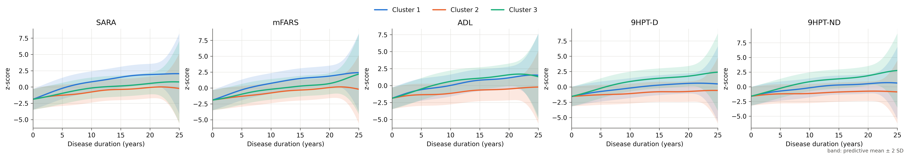
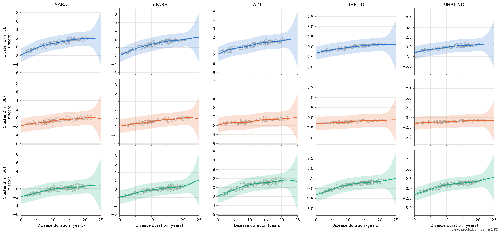
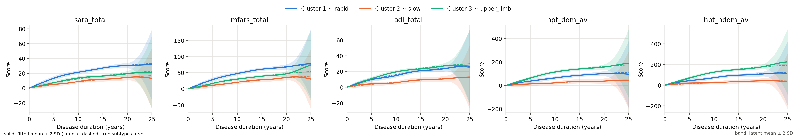

# Anchored Multivariate Mixture of Gaussian Processes for Disease Progression Subtypes

**Multivariate longitudinal clustering • Anchored Gaussian processes • Progression subtypes in Friedreich ataxia (FRDA)**


This repository contains the modelling code for the accompanying manuscript. It fits a
finite mixture of multitask Gaussian processes (MoGP) to sparse, irregular longitudinal clinical scores. Each
participant is assigned to one progression subtype, and each subtype is described by a smooth, monotone, multivariate
trajectory over disease duration that starts from a clinical anchor at disease onset.

No participant data are included. A simulator generates a dummy cohort with planted subtypes, so the full pipeline can
be run and checked end to end.

---

## Table of contents

1. [Overview](#overview)
2. [Repository structure](#repository-structure)
3. [Installation](#installation)
4. [Workflow overview](#workflow-overview)
5. [Step-by-step pipeline (dummy data)](#step-by-step-pipeline-dummy-data)
6. [Model](#model)
7. [Changing the model settings](#changing-the-model-settings)
8. [Using your own data](#using-your-own-data)
9. [Outputs](#outputs)
10. [Dummy vs user-provided data](#dummy-vs-user-provided-data)
11. [License](#license)

---

## Overview

- **Multivariate.** All outcomes (by default SARA, mFARS, ADL, 9HPT dominant and non-dominant hand) are modelled
  jointly in one multitask GP per subtype, so subtypes are defined by the combined pattern across scales.
- **Anchored.** Each subtype trajectory is pinned to a clinical anchor at disease duration 0 (by default a raw score
  of 0, converted to the z-score scale). The anchor is exact, not a soft penalty.
- **Monotone and smooth.** Training penalises decreasing or rough mean trajectories.
- **Hard-assignment EM.** Participants are clustered by the likelihood of their whole trajectory under each
  subtype GP. Participants that fit no subtype well can be left unassigned.
- **Configurable.** Kernel, lengthscale, noise level, priors, anchoring mode, penalties and EM settings are all exposed
  through one JSON config or command-line flags.

## Repository structure

```
fa-progression-mogp/
├── 01_fit_model.py                     # prepare data, fit the mixture, save results
├── 02_plot_trajectories.py             # progression and overlay figures from saved results
├── 03_select_k.py                      # compare numbers of clusters K
├── 04_check_recovery_on_dummy_data.py  # fitted vs planted subtypes (dummy data only)
├── configs/
│   ├── manuscript.json                 # settings used in the manuscript
│   └── demo.json                       # settings for the dummy-data demo
├── data/
│   └── generate_dummy_data.py          # writes data/dummy/*.csv
├── docs/figures/                       # demo figures shown in this README
├── mvmogp/                             # the Python package
│   ├── config.py                       # GPConfig, TrainConfig, MixtureConfig
│   ├── model.py                        # anchored multitask GP, training, scoring, prediction
│   ├── mixture.py                      # hard-assignment EM, initialisation, trimming
│   ├── preprocessing.py                # wide->long, site correction, z-scoring, anchor conversion
│   ├── metrics.py                      # log-likelihood, BIC, coverage, roughness, K selection
│   ├── plotting.py                     # plot_progression_trajectories, plot_overlay_trajectories
│   ├── io.py                           # save_results / load_results
│   ├── pipeline.py                     # run configuration + data preparation used by the scripts
│   └── simulate.py                     # synthetic cohort generator
├── tests/                              # pytest suite
├── environment.yml
├── requirements.txt
├── pyproject.toml
└── LICENSE
```

## Installation

Conda (recommended):

```bash
conda env create -f environment.yml
conda activate fa-progression-mogp
```

or pip:

```bash
pip install -r requirements.txt
```

A CUDA GPU is used automatically when available (`train.device = "auto"`); everything also runs on CPU. For a GPU
build of PyTorch, install it from <https://pytorch.org/get-started/> before the requirements.

Check the installation:

```bash
python -m pytest
```

## Workflow overview

```
generate_dummy_data.py ──► 01_fit_model.py ──► 02_plot_trajectories.py
   (or your own CSV)        site correction     progression_trajectories.png
                            z-scoring + anchor  overlay_trajectories.png
                            EM over K GPs
                            results/<run>/   ──► 03_select_k.py   (choose K)
                                             ──► 04_check_recovery_on_dummy_data.py
```

## Step-by-step pipeline (dummy data)

All commands are run from the repository root.

**1. Generate the dummy cohort** (150 participants, 3 planted subtypes, 1–3 yearly visits, 4 sites):

```bash
python data/generate_dummy_data.py
```

**2. Fit the model** with the demo settings (K = 3) and report recovery of the planted subtypes:

```bash
python 01_fit_model.py --truth data/dummy/dummy_truth.csv
```

**3. Plot the trajectories:**

```bash
python 02_plot_trajectories.py
```

**4. (Optional) Check recovery against the true curves, and compare K:**

```bash
python 04_check_recovery_on_dummy_data.py
python 03_select_k.py
```

On the default dummy cohort (seed 0) the fit converges in a few EM iterations, every participant is placed with their
planted subtype (adjusted Rand index = 1.0 in our run), and the fitted mean trajectories follow the true subtype
curves. `03_select_k.py` favours K = 3 by BIC and restart stability. The fit takes about one minute on a GPU and a
few minutes on a CPU.

| Progression trajectories (`02`, z-scores, predictive band) |
|---|
|  |

| Observed trajectories with the subtype GP overlaid (`02`) |
|---|
|  |

| Fitted (solid) vs true (dashed) subtype curves, raw units (`04`) |
|---|
|  |

## Model

**Data.** Visit $j$ of participant $i$ has disease duration $t_{ij}$ and a vector of $D$ outcomes $\mathbf{y}_{ij}$,
z-scored per outcome. The raw anchor $a^{\text{raw}}_d$ (default 0) is converted with the same mean and SD:
$a_d = (a^{\text{raw}}_d - \bar{y}_d)/s_d$.

**One subtype.** For cluster $k$ and outcome $d$:

```math
f_{kd}(t) = a_d + b_{kd}\, t + g_{kd}(t), \qquad b_{kd} > 0
```

```math
\mathrm{cov}\big(g_{kd}(t),\, g_{kd'}(t')\big) = B_k[d,d'] \cdot \sigma^2_k \cdot t\, t' \cdot \kappa_{\ell_k}(t,t')
```

```math
B_k = \mathbf{w}_k\mathbf{w}_k^\top + \mathrm{diag}(\mathbf{v}_k)
```

```math
y_{ijd} = f_{kd}(t_{ij}) + \varepsilon_{ijd}, \qquad \varepsilon_{ijd} \sim \mathcal{N}\big(0,\ \tau^2_{kd} + \tau^2_k\big)
```

$\kappa_\ell$ is a stationary kernel (RBF by default) with lengthscale $\ell \ge 4$ years; $B_k$ links the outcomes
(intrinsic coregionalisation, rank 1 by default). The factor $t \cdot t'$ makes the GP variance zero at $t=0$, so every
subtype trajectory passes exactly through the anchor at onset.

**Training one subtype.** Hyperparameters maximise the exact marginal likelihood (with priors) minus two shape
penalties on the posterior mean $\mu(t)$ over a grid on $[0, 25]$ years:

```math
\mathcal{L} = -\log p(\mathbf{y} \mid \theta) + \lambda_{\text{mono}}\, \overline{\max(0, -\Delta\mu)^2} + \lambda_{\text{smooth}}\, \overline{(\Delta^2\mu)^2}
```

with $\lambda_{\text{mono}} = 15$, $\lambda_{\text{smooth}} = 0.5$, optimised with Adam.

**Clustering.** Hard-assignment EM:

1. Initialise clusters with KMeans on per-participant summaries (first visit time, first values, slopes).
2. *M-step:* fit one subtype GP per cluster on its members' pooled visits.
3. *E-step:* move each participant to the cluster with the highest joint log predictive density of their whole
   trajectory, $\arg\max_k \log p(\mathbf{Y}_i \mid \mathbf{t}_i, \mathcal{GP}_k)$.
4. *Trimming:* in clusters of at least 20 members, up to 8% of members whose mean absolute standardised residual is
   at least 1.5 are set to unassigned (−1), capped at 8% of all participants overall. Clusters with fewer than 10
   members are dissolved.
5. Repeat until no assignment changes, then refit every cluster on its final members.

## Changing the model settings

Every setting lives in a JSON config with four sections (`data`, `gp`, `train`, `mixture`); see
[`configs/manuscript.json`](configs/manuscript.json) for the full list with the manuscript values. Settings can be
overridden on the command line, either with a dedicated flag or with `--set section.field=value` (values are parsed as
JSON):

```bash
# kernel and lengthscale
python 01_fit_model.py --kernel matern52 --lengthscale-min 2 --lengthscale-init 6
python 01_fit_model.py --set "gp.lengthscale_prior=[3, 0.5]"

# noise level: lower bound, initial value, or fixed noise
python 01_fit_model.py --noise-min 0.05
python 01_fit_model.py --noise-init 0.3 --fix-noise

# anchoring: exact (hard), penalty (soft) or none; anchor values in raw units
python 01_fit_model.py --anchor soft --set train.lambda_anchor=20
python 01_fit_model.py --anchor-raw 0 0 0 20 20

# training and clustering
python 01_fit_model.py --n-clusters 4 --gp-iters 300 --lr 0.02 --lambda-mono 0 --no-unassigned
python 01_fit_model.py --set gp.task_rank=2 --set mixture.trim_abs_z_threshold=2.0
```

Main settings:

| Section.field | Default | Meaning |
|---|---|---|
| `gp.anchor` | `"hard"` | `hard`: exact anchor at t = 0; `soft`: free intercept + penalty `lambda_anchor`; `none`: no anchor |
| `gp.kernel` | `"rbf"` | `rbf`, `matern12`, `matern32`, `matern52`, `rq` |
| `gp.lengthscale_min` | `4.0` | lower bound on the lengthscale (years) |
| `gp.lengthscale_init` | `null` | initial lengthscale (`null` = just above the bound) |
| `gp.lengthscale_prior` | `[4.0, 0.5]` | Gamma(concentration, rate) prior, mean 8 years; `null` = none |
| `gp.outputscale_prior` | `[2.0, 2.0]` | Gamma prior on the GP output scale; `null` = none |
| `gp.slope_init`, `gp.slope_prior_sd` | `0.05`, `0.35` | initial positive slope (z/year) and log-scale SD of its LogNormal prior |
| `gp.task_rank` | `1` | rank of the cross-outcome covariance |
| `gp.noise_min` | `0.01` | lower bound on each noise variance (z-units²) |
| `gp.noise_init` | `null` | initial total noise variance per outcome |
| `gp.learn_noise` | `true` | `false` keeps the noise at `noise_init` |
| `train.n_iter`, `train.lr` | `100`, `0.01` | Adam iterations and learning rate per GP fit |
| `train.lambda_mono`, `train.lambda_smooth` | `15`, `0.5` | monotonicity and smoothness penalty weights |
| `train.grid_min`, `train.grid_max` | `0`, `25` | time range on which the penalties are evaluated |
| `mixture.n_clusters` | `4` | number of clusters K |
| `mixture.max_em_iters` | `50` | maximum EM iterations |
| `mixture.init_random_state`, `mixture.n_restarts` | `0`, `1` | KMeans seed; number of EM restarts (best total log-likelihood kept) |
| `mixture.min_cluster_size` | `10` | smaller clusters are dissolved |
| `mixture.allow_unassigned` | `true` | allow poorly fitting participants to stay unassigned |
| `mixture.trim_*`, `mixture.max_unassigned_frac` | see config | trimming rule described in [Model](#model) |
| `data.anchor_raw` | `0.0` | raw anchor value(s) at disease duration 0 |
| `data.site_correction` | `true` | remove additive site effects before z-scoring |

With `train.lr = 0.01`, far fewer than ~100 iterations per GP fit leaves the hyperparameters close to their initial
values. On the dummy cohort, 40 iterations lowered recovery of the planted subtypes from an adjusted Rand index of 1.0
to about 0.6. If you change the learning rate, kernel or priors, check the loss traces in `training_log.csv`.

The same objects can be used directly from Python:

```python
import pandas as pd
from mvmogp import ModelConfig, fit_mixture, plot_overlay_trajectories, plot_progression_trajectories
from mvmogp.pipeline import DataConfig, prepare_data

prep = prepare_data(pd.read_csv("data/dummy/dummy_longitudinal.csv"), DataConfig(site_correction=True))

cfg = ModelConfig()
cfg.mixture.n_clusters = 3
cfg.gp.kernel = "matern52"
cfg.gp.lengthscale_min = 3.0
cfg.gp.noise_min = 0.05

result = fit_mixture(prep["times"], prep["values"], prep["patient_ids"], prep["anchor_z"], cfg,
                     outcome_names=prep["z_cols"])

plot_progression_trajectories(result, band="latent", save_path="progression.png")
plot_overlay_trajectories(result, prep["data"], scale="raw", scaler=prep["scaler"], save_path="overlay.png")
```

**Plot options.** Both plotting functions accept `band="predictive"` (where a new noisy visit is expected; the default)
or `band="latent"` (uncertainty of the mean trajectory only), `n_sd` (band half-width, default 2), `show_band`,
`scale="z"` or `"raw"`, `t_min`/`t_max`, `outcomes`, `outcome_labels`, `cluster_labels` and `colors`.

## Using your own data

The input is a long CSV with **one row per visit**:

| column | description |
|---|---|
| `participant_id` | participant identifier |
| `disease_duration` | years since symptom onset at the visit |
| one column per outcome | raw scores, e.g. `sara_total`, `mfars_total`, `adl_total`, `hpt_dom_av`, `hpt_ndom_av` |
| `site`, `visit` | only needed when `data.site_correction` is `true` |

Visits with a missing outcome are dropped, and each (participant, time) pair must be unique. Column names, outcomes and
labels are set in the `data` section of the config. Data in wide format (`sara_total_v1`, `sara_total_v2`, …, plus a
baseline duration) can be converted with `mvmogp.preprocessing.wide_to_long`. Cohort selection (e.g. the onset-age
criterion used in the manuscript) should be applied to the CSV before fitting. In the manuscript, site effects were
estimated on the full cohort before that selection; to reproduce this exactly, run
`mvmogp.preprocessing.site_correct` on the full cohort, then filter, then fit with `data.site_correction=false`.

```bash
python 01_fit_model.py --data path/to/cohort.csv --config configs/manuscript.json --out results/cohort
python 02_plot_trajectories.py --results results/cohort --t-max 18
```

## Outputs

`01_fit_model.py` writes to `results/<run>/`:

| file | content |
|---|---|
| `model_checkpoint.pth` | GP states, training data, config, anchor and z-score parameters (reload with `mvmogp.load_results`) |
| `assignments.csv` | cluster of each participant (−1 = unassigned) |
| `data_with_clusters.csv` | prepared visits with z-scores and cluster labels |
| `diagnostics.csv` | per-participant log-likelihood under every cluster, margin, residual score, trimming flag |
| `trajectories_{predictive,latent}[_raw].csv` | cluster mean ± 2 SD on a time grid, in z and raw units |
| `hyperparameters.json` | learned slopes, lengthscale, output scale, task covariance and noise per cluster |
| `metrics.json` | cluster sizes, total log-likelihood, BIC, time coverage, roughness (and recovery on dummy data) |
| `training_log.csv`, `config.json`, `metadata.json` | loss traces, exact settings and run metadata |
| `restarts.csv` | log-likelihood of every EM restart (only when `mixture.n_restarts > 1`) |

`02_plot_trajectories.py` adds `figures/progression_trajectories.png` and `figures/overlay_trajectories.png`.

## Dummy vs user-provided data

| Component | Provided? | Used by |
|---|---|---|
| Dummy cohort generator (`data/generate_dummy_data.py`) | Yes | all scripts, tests |
| Clinical cohort data analysed in the manuscript | **No** | see the manuscript's Data Availability statement |

The dummy cohort is generated from hand-chosen illustrative curves; it is not derived from, and does not reproduce, any
participant data.

## License

Released under the [MIT License](LICENSE).
